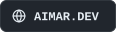
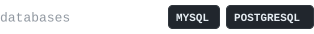

<div align="center">

<a href="https://aimar.dev">
  <picture>
    <source media="(prefers-color-scheme: dark)" srcset="assets/banner-dark.svg" />
    <source media="(prefers-color-scheme: light)" srcset="assets/banner-light.svg" />
    
  </picture>
</a>

<br /><br />

<a href="https://aimar.dev"><picture><source media="(prefers-color-scheme: light)" srcset="assets/badges/portfolio-light.svg" /></picture></a>
<a href="https://www.linkedin.com/in/aimarmndz"><picture><source media="(prefers-color-scheme: light)" srcset="assets/badges/linkedin-light.svg" /></picture></a>
<a href="mailto:contact@aimar.dev"><picture><source media="(prefers-color-scheme: light)" srcset="assets/badges/email-light.svg" /></picture></a>
<a href="https://discord.com/users/aimarmndz"><picture><source media="(prefers-color-scheme: light)" srcset="assets/badges/discord-light.svg" /></picture></a>

</div>

## ~/about

I'm a **Junior DevOps & SysAdmin** who enjoys building reliable systems, automating repetitive work, and squeezing every drop of performance out of the stack. I split my time between **infrastructure, databases, and the ever-growing DevOps toolbelt**.

```yaml
role: Junior DevOps & SysAdmin
company: Arenna Labs
location: Canary Islands, Spain
focus: [systems, automation, databases, reliability]
learning: [docker, kubernetes, ci/cd, cloud-native]
motto: "Automate everything that breaks more than once."
```

## ~/now

- Engineering at [**Arenna Labs**](http://www.arennalabs.com/)
- Going deeper into **Docker**, **Kubernetes** and CI/CD pipelines
- Ask me about **Linux, databases, automation or homelab stuff**

## ~/projects

| Project | What it does | Stack |
| :-- | :-- | :-- |
| [**scan2nas**](https://github.com/Aimarmndz/scan2nas) | Preset-based document scanning for Epson scanners on Linux, straight to a PDF on your NAS. CLI + Qt GUI. | Python |
| [**orgtable**](https://github.com/Aimarmndz/orgtable) | Free, open-source Kanban boards for people and companies, with organizations, roles and real time. A self-hostable Trello alternative. | TypeScript |
| [**vibe&#8209;gambling**](https://github.com/Aimarmndz/vibe-gambling) | Every prompt is a spin: a PS1-style roulette for Claude Code. Fake coins, real dopamine. | TypeScript |

## ~/stack

<picture><source media="(prefers-color-scheme: light)" srcset="assets/badges/stack-infra-light.svg" /></picture><br />
<picture><source media="(prefers-color-scheme: light)" srcset="assets/badges/stack-databases-light.svg" /></picture><br />
<picture><source media="(prefers-color-scheme: light)" srcset="assets/badges/stack-languages-light.svg" /></picture><br />
<picture><source media="(prefers-color-scheme: light)" srcset="assets/badges/stack-tools-light.svg" /></picture>

## ~/activity

<div align="center">

<picture>
  <source media="(prefers-color-scheme: dark)" srcset="https://raw.githubusercontent.com/aimarmndz/aimarmndz/output/github-contribution-grid-snake-dark.svg" />
  <source media="(prefers-color-scheme: light)" srcset="https://raw.githubusercontent.com/aimarmndz/aimarmndz/output/github-contribution-grid-snake.svg" />
  
</picture>

</div>

---

<div align="center">

Want to talk **infrastructure, automation or a side project**? My inbox is open: [contact@aimar.dev](mailto:contact@aimar.dev)

<a href="https://www.ko-fi.com/aimarmndz"><picture><source media="(prefers-color-scheme: light)" srcset="assets/badges/kofi-light.svg" /></picture></a>

<sub>Built with care in the Canary Islands</sub>

</div>
