<div align="center">

<a href="https://aimar.dev">
  <picture>
    <source media="(prefers-color-scheme: dark)" srcset="assets/banner-dark.svg" />
    <source media="(prefers-color-scheme: light)" srcset="assets/banner-light.svg" />
    
  </picture>
</a>

<br /><br />

<a href="https://aimar.dev"></a>
<a href="https://www.linkedin.com/in/aimarmndz"></a>
<a href="mailto:contact@aimar.dev"></a>
<a href="https://discord.com/users/aimarmndz"></a>


<a href="https://github.com/aimarmndz?tab=followers"></a>

</div>

## ~/about

I'm a **Junior DevOps & SysAdmin** who enjoys building reliable systems, automating repetitive work, and squeezing every drop of performance out of the stack. I split my time between **infrastructure, databases, and the ever-growing DevOps toolbelt**.

```yaml
role: Junior DevOps & SysAdmin
company: Arenna Labs
location: Canary Islands, Spain
focus: [systems, automation, databases, reliability]
learning: [docker, kubernetes, ci/cd, cloud-native]
motto: "Automate everything that breaks more than once."
```

## ~/now

- Engineering at [**Arenna Labs**](http://www.arennalabs.com/)
- Going deeper into **Docker**, **Kubernetes** and CI/CD pipelines
- Ask me about **Linux, databases, automation or homelab stuff**

## ~/projects

| Project | What it does | Stack |
| :-- | :-- | :-- |
| [**scan2nas**](https://github.com/Aimarmndz/scan2nas) | Preset-based document scanning for Epson scanners on Linux, straight to a PDF on your NAS. CLI + Qt GUI. | Python |
| [**orgtable**](https://github.com/Aimarmndz/orgtable) | Free, open-source Kanban boards for people and companies, with organizations, roles and real time. A self-hostable Trello alternative. | TypeScript |
| [**vibe-gambling**](https://github.com/Aimarmndz/vibe-gambling) | Every prompt is a spin: a PS1-style roulette for Claude Code. Fake coins, real dopamine. | TypeScript |

## ~/stack

| | |
| :-- | :-- |
| `infra & cloud` |      |
| `databases` |   |
| `languages` |       |
| `frameworks & tools` |         |

## ~/activity

<div align="center">

<picture>
  <source media="(prefers-color-scheme: dark)" srcset="https://streak-stats.demolab.com?user=aimarmndz&background=0d1117&border=30363d&stroke=30363d&ring=3fb950&fire=3fb950&currStreakNum=e6edf3&sideNums=e6edf3&currStreakLabel=3fb950&sideLabels=9198a1&dates=9198a1" />
  <source media="(prefers-color-scheme: light)" srcset="https://streak-stats.demolab.com?user=aimarmndz&background=ffffff&border=d1d9e0&stroke=d1d9e0&ring=1a7f37&fire=1a7f37&currStreakNum=1f2328&sideNums=1f2328&currStreakLabel=1a7f37&sideLabels=59636e&dates=59636e" />
  
</picture>

<br /><br />

<picture>
  <source media="(prefers-color-scheme: dark)" srcset="https://raw.githubusercontent.com/aimarmndz/aimarmndz/output/github-contribution-grid-snake-dark.svg" />
  <source media="(prefers-color-scheme: light)" srcset="https://raw.githubusercontent.com/aimarmndz/aimarmndz/output/github-contribution-grid-snake.svg" />
  
</picture>

</div>

---

<div align="center">

Want to talk **infrastructure, automation or a side project**? My inbox is open: [contact@aimar.dev](mailto:contact@aimar.dev)

<a href="https://www.ko-fi.com/aimarmndz"></a>

<sub>Built with care in the Canary Islands</sub>

</div>
